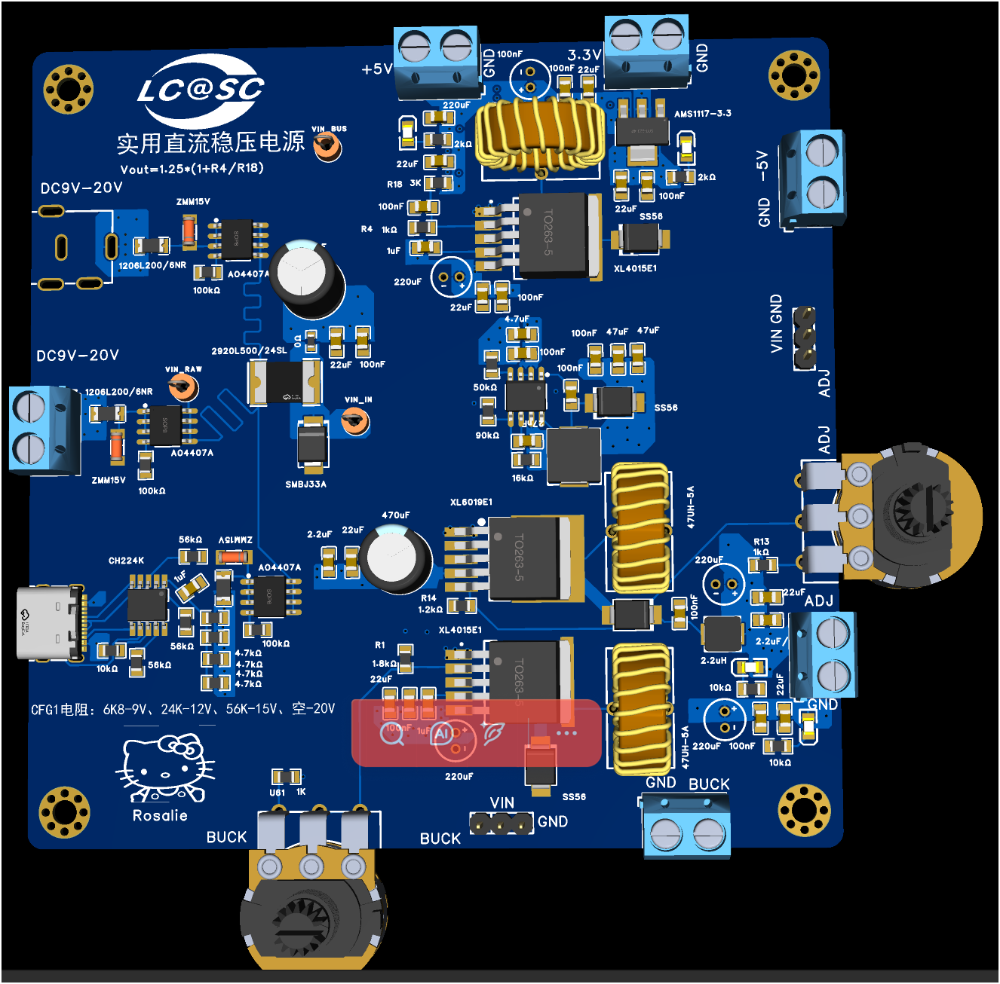
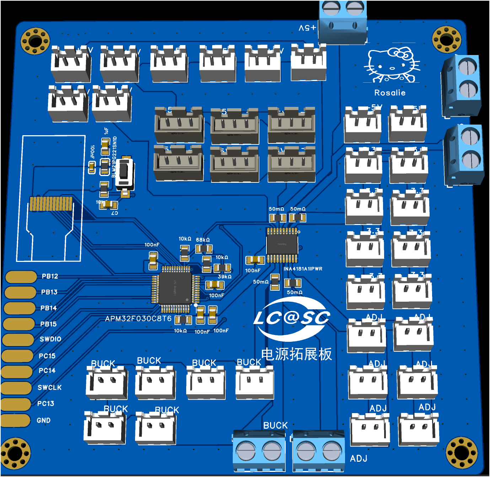

# OpenPowerLab

**Open-source modular DC power supply & power expansion board**

[](LICENSE)
[](https://www.oshwa.org/definition/)
[](firmware/)
[](https://pro.lceda.cn/)
[](CONTRIBUTING.md)

[简体中文](README.md) | **English**


&nbsp;&nbsp;&nbsp;


*Left: adjustable power supply board | Right: power expansion board*

> [!NOTE]
> The **power supply board has been assembled and verified**; all outputs work as expected.
> The expansion board has been built. Assembly photos will be added later.
> **Only one of the three input ports may be powered at a time** — never power multiple inputs simultaneously.
> Always verify output voltage and polarity before connecting a load.

> [!WARNING]
> This is a personal, educational open hardware project — **not a certified commercial power supply**.
> Most nominal specifications come from component datasheets and have not been fully validated.
> Read the [safety guide](docs/safety.md) and [test plan](docs/testing.md) before driving any real load.

## Table of Contents

- [Overview](#overview)
- [Features](#features)
- [Specifications](#specifications)
- [System Architecture](#system-architecture)
- [Repository Layout](#repository-layout)
- [Getting Started](#getting-started)
- [Board Details](#board-details)
- [Bill of Materials](#bill-of-materials)
- [Known Issues & Limitations](#known-issues--limitations)
- [Roadmap](#roadmap)
- [Contributing](#contributing)
- [License](#license)

## Overview

OpenPowerLab is an open hardware project built around two complementary modules:

1. **Power Supply Board** — three selectable DC inputs (one active at a time), multiple fixed-voltage rails, two independent adjustable outputs, and USB-C PD input support.
2. **Power Expansion Board** — built around an APM32F030C8T6 (Arm Cortex-M0) MCU and an INA4181 quad-channel current-sense amplifier. It fans the incoming rails out to many connectors and provides real-time voltage/current monitoring.

> 💬 *This is my first power supply board design. Many aspects still need refinement — please use it with care and feel free to point out issues.*

Design files are created in **EasyEDA Pro**; the firmware is **C99** against the APM32 standard peripheral library. Schematics, BOM, firmware and documentation are all published, so the build can be reproduced end to end.

## Features

| Category | Feature |
| --- | --- |
| **Input** | 3 selectable DC inputs (barrel jack, USB-C PD, screw terminal), 9–20 V range |
| **Fixed outputs** | +3.3 V / +5 V / −5 V rails |
| **Adjustable outputs** | 2 independent adjustable DC outputs via potentiometers |
| **Protection** | Input fuses, TVS clamping, reverse-polarity protection (AO4407A) |
| **USB-C PD** | CH224K PD sink controller for USB-C power input |
| **Monitoring** | 4-channel simultaneous voltage/current sensing via INA4181 |
| **Display** | 0.96" OLED, SSD1306 over SPI |
| **Debug** | SWD header for in-circuit debug and flashing |
| **Tooling** | EasyEDA Pro project files |

## Specifications

### Power Supply Board

| Parameter | Value | Note |
| --- | --- | --- |
| Input voltage | **9 – 20 V DC** | 3 inputs, one active |
| Input connectors | Barrel jack / USB-C / 5.08 mm terminal | Never power two at once |
| +3.3 V rail | AMS1117-3.3 LDO | 1 A nominal |
| +5 V rail | XL4015 buck | 5 A nominal |
| −5 V rail | XL6019 inverting | Verified working |
| Adjustable outputs 1 / 2 | XL4015 buck, adjustable | WH148 potentiometer |
| Switching frequency | ~180 kHz (XL4015) | |
| On-board fuses | 1206L200/6NR (2 A) ×3 | One per input |
| PCB size | 100 mm × 100 mm | 2-layer |

### Power Expansion Board

| Parameter | Value | Note |
| --- | --- | --- |
| MCU | **APM32F030C8T6** | Arm Cortex-M0, 48 MHz, 64 KB Flash |
| Current sense | **INA4181A1IPWR** | 4-channel, bidirectional, zero-drift |
| Shunt resistors | 50 mΩ × 4 | 0805 package |
| ADC | 12-bit SAR (internal) | up to 1 Msps |
| Display | 0.96" OLED (HS096T01H13) | SPI, 128×64 |
| Debug | SWD / GPIO expansion | |
| Supply | +5 V from the power board | |
| Outputs | +5 V, +3.3 V, ±5 V, ADJ, BUCK | XH2.54-2P, grouped by rail |
| Channels | 4 voltage + 4 current | 4 rails monitored |
| PCB size | 100 mm × 100 mm | 2-layer |

> [!NOTE]
> Nominal figures come from component datasheets. Actual current capability, ripple and efficiency require measurement — see [docs/testing.md](docs/testing.md).

## System Architecture

```
                        ┌──────────────────────────────────────────┐
                        │          Power Supply Board              │
                        │                                          │
  DC 9-20V ──┬── Jack ──┤  ┌─────────┐  ┌─────────┐  ┌─────────┐  │
             │          ├─►│  Input  │─►│  Power  │─►│  Rails  │  │
  USB-C PD ──┤          │  │ Protect │  │  Dist.  │  │         │  │
             │          │  └─────────┘  └────┬────┘  └────┬────┘  │
  Terminal ──┘          │              ┌─────▼──────┐       │       │
                        │              │ +3.3V LDO  │       │       │
                        │              │ +5V BUCK   │       │       │
                        │              │ -5V BOOST  │       │       │
                        │              │ ADJ1 BUCK  │       │       │
                        │              │ ADJ2 BUCK  │       │       │
                        │              └─────┬──────┘       │       │
                        └────────────────────┼──────────────┼───────┘
                                             │              │
                                  power/signal│              │ V/I sensing
                                             │              │
                        ┌────────────────────▼──────────────▼───────┐
                        │        Power Expansion Board               │
                        │                                            │
                        │   ┌─────────────┐    ┌──────────────┐     │
                        │   │ APM32F030   │◄──►│  INA4181     │     │
                        │   │   MCU       │    │  4ch sense   │     │
                        │   └──────┬──────┘    └──────┬───────┘     │
                        │          │                  │             │
                        │   ┌──────▼──────┐    ┌──────▼───────┐     │
                        │   │  OLED (SPI) │    │  V dividers  │     │
                        │   └─────────────┘    └──────────────┘     │
                        │                                            │
                        │  Outputs: +5V / +3.3V / ±5V / ADJ / BUCK   │
                        └────────────────────────────────────────────┘
```

## Repository Layout

```
OpenPowerLab/
├── README.md                    # Chinese README (primary)
├── README.en.md                 # This file
├── CHANGELOG.md                 # Changelog
├── CONTRIBUTING.md              # Contribution guide
├── LICENSE                      # GNU GPL v3.0 (whole project)
├── .github/                     # Issue / PR templates
├── hardware/
│   ├── power-board/             # Adjustable power supply board
│   │   ├── README.md
│   │   ├── BOM.csv
│   │   ├── source/POWER.epro2   # EasyEDA Pro project
│   │   └── gerber/power_expand.zip
│   └── monitoring-board/        # Power expansion board
│       ├── README.md
│       └── BOM.csv
├── firmware/                    # Firmware (expansion board)
│   ├── README.md
│   ├── Src/
│   └── Inc/
├── docs/
│   ├── README.md                # Documentation index
│   ├── hardware.md              # Detailed hardware design
│   ├── safety.md                # Safety guide
│   └── testing.md               # Test & validation plan
└── images/
```

## Getting Started

### 1. Clone

```bash
git clone https://github.com/rosaliehhh666-del/OpenPowerLab.git
cd OpenPowerLab
```

### 2. Open the design

1. Install [EasyEDA Pro](https://pro.lceda.cn/)
2. Open `hardware/power-board/source/POWER.epro2`
3. Review the schematic and PCB layout

### 3. Fabricate

1. Confirm the Gerber export matches the current design
2. Submit `hardware/power-board/gerber/power_expand.zip` to a PCB vendor
3. Order components from the BOM

### 4. First power-up

> [!IMPORTANT]
> Always use a **current-limited supply** for the first power-up and start from the lowest input voltage.

1. Leave all outputs unloaded
2. Connect 9 V (limited to 0.5 A) to **one** input only
3. Verify each rail with a multimeter
4. Raise the input to 20 V gradually and watch for instability
5. Follow [docs/safety.md](docs/safety.md) and [docs/testing.md](docs/testing.md)

### 5. Flash the firmware

1. Connect an SWD probe
2. Flash with Keil MDK or OpenOCD
3. See [firmware/README.md](firmware/README.md)

## Board Details

### Power Supply Board

| IC | Function | Qty |
| --- | --- | --- |
| XL4015E1 | 5 A step-down DC-DC | 2 |
| XL6019E1 | Inverting DC-DC (−5 V) | 1 |
| AMS1117-3.3 | 3.3 V LDO | 1 |
| CH224K | USB-C PD sink controller | 1 |
| AO4407A | P-MOSFET reverse-polarity protection | 3 |
| SS56 | Schottky diode (5 A / 60 V) | 4 |
| SMBJ33A | TVS diode | 1 |

- **Inputs**: barrel jack (DC-005IB, 2.1 mm centre-positive), USB-C (PD sink, 9/12/15/20 V), 5.08 mm screw terminal
- **Outputs**: +3.3 V / +5 V / −5 V on screw terminals; ADJ1 / ADJ2 on screw terminals with WH148 potentiometers
- **PD voltage select (CFG1)**: 6K8 → 9 V, 24K → 12 V, 56K → 15 V, open → 20 V

### Power Expansion Board

| IC | Function | Qty |
| --- | --- | --- |
| APM32F030C8T6 | Arm Cortex-M0 MCU, 48 MHz, 64 KB Flash | 1 |
| INA4181A1IPWR | Quad bidirectional current-sense amplifier | 1 |
| HS096T01H13 | 0.96" 128×64 OLED | 1 |
| BLM21PG221SN1D | Ferrite bead (supply filtering) | 1 |

- Connector groups: 8× +5 V, 8× +3.3 V, 8× ±5 V, ADJ, 6× BUCK, plus 6× XH2.54-3P signal headers and 5× 5.08 mm terminals
- Current sensing: 50 mΩ shunts, INA4181 gain 20 V/V, ≈ ±3.3 A full scale
- Voltage sensing: 68 kΩ / 10 kΩ dividers, ≈ 25.7 V maximum

## Bill of Materials

| Board | Part count | File |
| --- | --- | --- |
| Power supply board | 52 types | [BOM.csv](hardware/power-board/BOM.csv) |
| Power expansion board | 16 types | [BOM.csv](hardware/monitoring-board/BOM.csv) |

Components are sourced mainly from **LCSC**; the BOM files include LCSC part numbers for direct import.

## Known Issues & Limitations

- **Expansion board design files**: The editable [POWER.epro2](hardware/power-board/source/POWER.epro2) contains the expansion schematic (`Board2 → Schematic3 → P1`) and layout (`PCB2`). Separate expansion-board Gerbers have yet to be published.
- **Firmware project**: the Keil MDK project is not committed yet — only sources are available
- **Firmware maturity**: skeleton implementation; calibration and alarm features are incomplete
- **Pin conflicts**: PA5 / PA6 / PA7 are shared between ADC current sensing and SPI1 (OLED); this must be resolved in the final hardware revision
- **Electrical data**: current limits, ripple, efficiency and thermal behaviour are nominal, not measured
- **Protection**: OCP / OVP / short-circuit / reverse-polarity behaviour is not fully validated

## Roadmap

- [x] Power board schematic and PCB
- [x] Power board BOM
- [x] −5 V rail validated (XL6019)
- [x] Power board assembled and functionally verified
- [ ] Full power board characterisation (load / ripple / efficiency / thermal)
- [x] Publish editable expansion board design
- [x] Build expansion board
- [ ] Add expansion board assembly photos
- [ ] v1.0 hardware release

## Contributing

Issues and pull requests are welcome. Because the project is GPL-3.0, derivative designs must also be released as open source.

- **Hardware bugs**: report board revision, input voltage, load, measured pin values and instrument used
- **Design changes**: open an issue first, include schematic/PCB rationale and test data
- **Firmware**: follow the existing style, include a functional description and test results
- **Documentation**: corrections and translations are very welcome

See [CONTRIBUTING.md](CONTRIBUTING.md) for details.

## License

All contents of this project — hardware design files, firmware sources, documentation and images — are licensed under the
**[GNU General Public License v3.0](LICENSE)** (SPDX: `GPL-3.0-only`).

```
OpenPowerLab  Copyright (C) 2024-2026  Rosalie and OpenPowerLab Contributors

This program is free software: you can redistribute it and/or modify
it under the terms of the GNU General Public License as published by
the Free Software Foundation, either version 3 of the License, or
(at your option) any later version.
```

In short: you may use, modify, sell and redistribute this work, provided that derivative designs and firmware are
released under GPL-3.0 with the original notices retained. There is no warranty of any kind.

> [!NOTE]
> GPL-3.0 is a software licence built around the concepts of source and object code. It is applied here to hardware
> design files as well, as requested. If your use case demands a purpose-built hardware licence, consider
> [CERN-OHL-S-2.0](https://ohwr.org/cern_ohl_s_v2.txt).

© 2024-2026 OpenPowerLab Contributors · Designed with ❤️ by Rosalie
