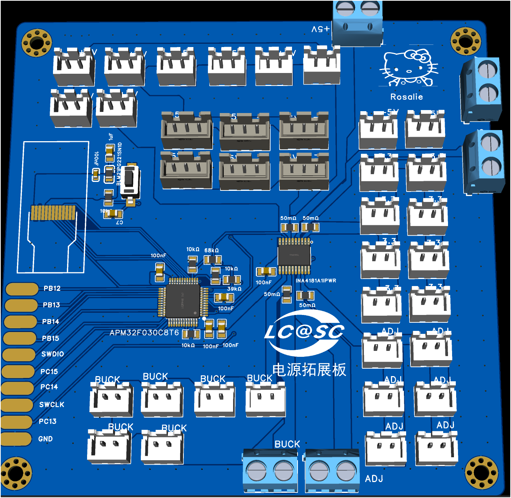
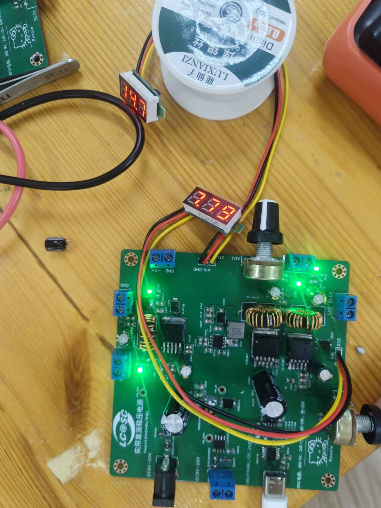

# OpenPowerLab

**开源模块化直流稳压电源与电源拓展板**


&nbsp;&nbsp;&nbsp;


*左：可调电源板 ｜ 右：电源拓展板*

> [!NOTE]
> **电源板已焊接验证**，各路输出工作正常。拓展板处于设计阶段，待打样验证。
> 三个可选电源输入端口中**仅可选择一路**供电，**严禁同时给多个输入端通电**。连接负载前请务必确认输出电压和极性。

## 目录

- [项目简介](#项目简介)
- [功能特性](#功能特性)
- [技术规格](#技术规格)
- [系统架构](#系统架构)
- [仓库结构](#仓库结构)
- [快速开始](#快速开始)
- [板卡详情](#板卡详情)
  - [可调电源板](#可调电源板)
  - [电源拓展板](#电源拓展板)
- [物料清单 (BOM)](#物料清单-bom)
- [已知问题与限制](#已知问题与限制)
- [开发路线图](#开发路线图)
- [贡献指南](#贡献指南)
- [许可证](#许可证)

## 项目简介

OpenPowerLab 是一个开源硬件项目，包含两个互补的模块：

1. **可调电源板 (Power Supply Board)** — 三路可选 DC 输入（单路工作）、多路固定电压输出、两路独立可调输出，支持 USB-C PD 输入。
2. **电源拓展板 (Power Expansion Board)** — 基于 APM32F030C8T6 微控制器和 INA4181 四通道电流检测放大器，提供 +5 V、+3.3 V、±5 V、ADJ、BUCK 等多路电源输出接口和实时电压电流监测功能。

> 💬 **萌新第一次画电源板，还有许多问题需要完善，请谨慎参考，求各位大佬多多指教，感谢！**

## 功能特性

| 类别 | 特性 |
| --- | --- |
| **输入** | 3 路可选 DC 输入（DC 插座、USB-C PD、接线端子），9–20 V 宽电压范围 |
| **固定输出** | +3.3 V / +5 V / −5 V 三路固定电压输出 |
| **可调输出** | 2 路独立可调 DC 输出，电位器调节 |
| **保护** | 输入保险丝、TVS 瞬态抑制、反接保护（AO4407A） |
| **USB-C PD** | CH224K PD 诱骗芯片，支持 USB-C 电源输入 |
| **监测** | 4 通道电压/电流同步采集，INA4181 高精度电流检测 |
| **显示** | 0.96 寸 OLED 显示屏接口（SPI 接口） |
| **调试** | SWD 调试接口，支持在线仿真与烧录 |
| **设计工具** | EasyEDA Pro 工程文件，立创EDA 兼容 |

## 技术规格

### 电源板规格

| 参数 | 规格 | 备注 |
| --- | --- | --- |
| 输入电压范围 | **9 – 20 V DC** | 三路输入，单路工作 |
| 输入接口 | DC 插座 / USB-C / 5.08 mm 接线端子 | 不可同时供电 |
| +3.3 V 输出 | AMS1117-3.3 线性稳压 | 最大 1 A（标称） |
| +5 V 输出 | XL4015 降压 | 最大 5 A（标称） |
| −5 V 输出 | XL6019 负压产生 | 已验证，工作正常 |
| 可调输出 1 (BUCK) | XL4015 降压可调 | 电位器 WH148 调节 |
| 可调输出 2 (BUCK) | XL4015 降压可调 | 电位器 WH148 调节 |
| 开关频率 | ~180 kHz (XL4015) | |
| 板载保险丝 | 1206L200/6NR (2A) x3 | 多路输入独立保险 |
| PCB 尺寸 | 100 mm × 100 mm | 双层板 |

### 电源拓展板规格

| 参数 | 规格 | 备注 |
| --- | --- | --- |
| 主控 MCU | **APM32F030C8T6** | ARM Cortex-M0，48 MHz，64 KB Flash |
| 电流检测 | **INA4181A1IPWR** | 4 通道，双向，零漂移 |
| 检测电阻 | 50 mΩ × 4 | 0805 封装 |
| ADC | 12-bit SAR ADC（MCU 内置） | 最高 1 Msps |
| 显示接口 | 0.96" OLED (HS096T01H13) | SPI 接口，128×64 |
| 通信接口 | SWD 调试 / GPIO 扩展 | |
| 输入电压 | +5 V | 由电源板 +5 V 供电 |
| 输出接口 | +5 V、+3.3 V、±5 V、ADJ、BUCK | XH2.54-2P 插座，分区排列 |
| 通道数 | 4 路电压 + 4 路电流 | 可监测 4 路输出 |
| PCB 尺寸 | 100 mm × 100 mm | 双层板 |

> [!NOTE]
> 上述标称参数基于元器件 datasheet，实际输出能力、纹波、效率等需经实测验证。请参考[测试文档](docs/testing.md)。

## 系统架构

```
                        ┌──────────────────────────────────────────┐
                        │           可调电源板 (Power Board)         │
                        │                                          │
  DC 9-20V ──┬── DC插座 ─┤  ┌─────────┐  ┌─────────┐  ┌─────────┐  │
             │           ├─►│ 输入保护 │─►│ 配电网络 │─►│ 各路稳压 │  │
  USB-C PD ──┤           │  └─────────┘  └────┬────┘  └────┬────┘  │
             │           │                    │              │       │
  接线端子 ──┘           │              ┌─────▼──────┐       │       │
                        │              │ +3.3V LDO  │       │       │
                        │              │ +5V BUCK   │       │       │
                        │              │ -5V BOOST  │       │       │
                        │              │ ADJ1 BUCK  │       │       │
                        │              │ ADJ2 BUCK  │       │       │
                        │              └─────┬──────┘       │       │
                        └────────────────────┼──────────────┼───────┘
                                             │              │
                                 电源/信号连接│              │ 电压/电流采样
                                             │              │
                        ┌────────────────────▼──────────────▼───────┐
                        │       电源拓展板 (Expansion Board)           │
                        │                                            │
                        │   ┌─────────────┐    ┌──────────────┐     │
                        │   │ APM32F030   │◄──►│  INA4181     │     │
                        │   │   MCU       │    │  4ch 电流检测 │     │
                        │   └──────┬──────┘    └──────┬───────┘     │
                        │          │                  │             │
                        │   ┌──────▼──────┐    ┌──────▼───────┐     │
                        │   │  OLED 显示   │    │  电压分压网络 │     │
                        │   │   (SPI)     │    │              │     │
                        │   └─────────────┘    └──────────────┘     │
                        │                                            │
                        │  输出接口: +5V / +3.3V / ±5V / ADJ / BUCK  │
                        └────────────────────────────────────────────┘
```

## 仓库结构

```
OpenPowerLab/
├── README.md                    # 项目说明（本文件）
├── CHANGELOG.md                 # 变更日志
├── CONTRIBUTING.md              # 贡献指南
├── LICENSE                      # 硬件许可证（CERN-OHL-S-2.0）
├── .gitignore                   # Git 忽略规则
├── hardware/
│   ├── power-board/             # 可调电源板
│   │   ├── README.md            # 电源板详细说明
│   │   ├── BOM.csv              # 物料清单
│   │   ├── source/
│   │   │   └── POWER.epro2      # EasyEDA Pro 工程源文件
│   │   └── gerber/
│   │       └── power_expand.zip # Gerber 制板文件
│   └── monitoring-board/        # 电源拓展板
│       ├── README.md            # 拓展板详细说明
│       └── BOM.csv              # 物料清单
├── firmware/                    # 固件源码（拓展板）
│   ├── README.md                # 固件说明
│   ├── Src/                     # 源代码
│   ├── Inc/                     # 头文件
│   └── MDK-ARM/                 # Keil MDK 工程
├── docs/                        # 文档
│   ├── hardware.md              # 硬件详细文档
│   ├── safety.md                # 安全使用指南
│   └── testing.md               # 测试与验证计划
└── images/                      # 图片资源
    ├── power-supply-board.png   # 电源板渲染图
    └── monitoring-expansion-board.png  # 监测板渲染图
```

## 快速开始

### 1. 获取项目

```bash
git clone https://github.com/rosaliehhh666-del/OpenPowerLab.git
cd OpenPowerLab
```

### 2. 查看硬件设计

1. 下载并安装 [立创EDA 专业版 (EasyEDA Pro)](https://pro.lceda.cn/)
2. 打开 `hardware/power-board/source/POWER.epro2` 查看电源板工程
3. 审查原理图和 PCB 布局

### 3. 制板打样

1. 确认 Gerber 文件版本与设计一致
2. 使用 `hardware/power-board/gerber/power_expand.zip` 提交 PCB 厂商
3. 按照 BOM 清单采购元器件

### 4. 上电测试

> [!IMPORTANT]
> 首次上电务必使用**限流电源**，从最低输入电压开始测试。

1. 确保所有输出端未连接负载
2. 选择**一路**输入接口连接 9 V 限流电源（限流 0.5 A）
3. 用万用表测量各输出电压是否正常
4. 逐步提高输入电压至 20 V，观察输出稳定性
5. 参考 [安全指南](docs/safety.md) 和 [测试计划](docs/testing.md)

### 5. 固件烧录（拓展板）

1. 通过 SWD 接口连接调试器
2. 使用 Keil MDK 或 OpenOCD 烧录固件
3. 参考 [固件说明](firmware/README.md)

## 板卡详情

### 可调电源板




*焊接实物图 — 已验证工作正常 ✅*

**核心芯片：**

| 芯片 | 功能 | 数量 |
| --- | --- | --- |
| XL4015E1 | 5A 降压型 DC-DC 转换器 | 2 |
| XL6019E1 | 升压型 DC-DC 转换器（-5V 负压） | 1 |
| AMS1117-3.3 | 3.3 V 线性稳压器 | 1 |
| CH224K | USB-C PD 诱骗控制器 | 1 |
| AO4407A | P-MOSFET（输入反接保护） | 3 |
| SS56 | 肖特基二极管（5A/60V） | 4 |
| SMBJ33A | TVS 瞬态抑制二极管 | 1 |

**输入接口：**
- **DC 插座** (DC-005IB-2.1-09)：2.1 mm 中心正极
- **USB-C** (Type-C 16P)：PD 诱骗，支持 9V/12V/15V/20V
- **5.08 mm 接线端子**：大电流输入

**输出接口：**
- +3.3 V / +5 V / −5 V：5.08 mm 接线端子
- ADJ1 / ADJ2：5.08 mm 接线端子 + WH148 电位器
- 测试点：VIN_RAW、VIN_BUS 等关键节点

**配置选项：**
- CFG1 电阻配置：6K8→9V、24K→12V、56K→15V、空→20V（CH224K PD 电压选择）

详细信息请参考 [电源板 README](hardware/power-board/README.md) 和 [BOM 清单](hardware/power-board/BOM.csv)。

### 电源拓展板


**核心芯片：**

| 芯片 | 功能 | 数量 |
| --- | --- | --- |
| APM32F030C8T6 | ARM Cortex-M0 微控制器，48MHz，64KB Flash | 1 |
| INA4181A1IPWR | 四通道双向电流检测放大器，零漂移 | 1 |
| HS096T01H13 | 0.96 寸 OLED 显示屏（128×64，SPI） | 1 |
| BLM21PG221SN1D | 铁氧体磁珠（电源滤波） | 1 |

**主要接口（XH2.54-2P，分区排列）：**
- **+5 V 区**：8 路 +5 V 输出（电源板 +5 V 输入 → 多路扩展输出）
- **+3.3 V 区**：8 路 +3.3 V 输出
- **±5 V 区**：8 路（+5 V / −5 V 各 4 路）
- **ADJ 区**：可调电压输入输出
- **BUCK 区**：6 路 BUCK 输出接口
- **XH2.54-3P** x6：扩展信号接口
- **5.08 mm 接线端子** x5：大电流输入/输出
- **SWD 接口**：PB12/SWDIO、PB13/SWCLK、PB14/PB15/GPIO

**检测通道：**
- 4 路电流检测：50 mΩ 采样电阻，INA4181 增益 20V/V
- 4 路电压检测：电阻分压网络，适配 MCU ADC 输入范围

详细信息请参考 [电源拓展板 README](hardware/monitoring-board/README.md) 和 [BOM 清单](hardware/monitoring-board/BOM.csv)。

## 物料清单 (BOM)

| 板卡 | 元器件数量 | BOM 文件 |
| --- | --- | --- |
| 可调电源板 | 52 种 | [hardware/power-board/BOM.csv](hardware/power-board/BOM.csv) |
| 电源拓展板 | 16 种 | [hardware/monitoring-board/BOM.csv](hardware/monitoring-board/BOM.csv) |

元器件主要采购自 **LCSC（立创商城）**，BOM 中包含 LCSC 料号，可直接导入立创 BOM 配单。

## 已知问题与限制

- **拓展板设计文件**：EasyEDA 源工程和 Gerber 文件尚未上传
- **固件**：拓展板固件为骨架版本，校准和告警功能待完善
- **电气参数**：输出电流极限、纹波、效率、温升等参数均为标称值，未经过实际测试
- **保护功能**：过流、过压、短路、反接等保护功能未经过完整验证

## 开发路线图

### 硬件

- [x] 电源板原理图与 PCB 设计
- [x] 电源板 BOM 清单
- [x] XL6019 负压电路验证
- [x] 电源板焊接与基本功能验证
- [ ] 电源板完整性能测试（负载/纹波/效率/温升）
- [ ] 拓展板设计文件开源
- [ ] 拓展板打样验证
- [ ] 发布 v1.0 正式版硬件

### 固件

- [x] 基础固件框架（GPIO、UART、ADC、SPI）
- [x] INA4181 驱动程序
- [x] OLED 显示驱动（SPI）
- [ ] 电压电流采集与校准
- [ ] 数据串口输出
- [ ] 过压/过流告警功能

### 文档

- [x] 项目 README 和基础文档
- [x] BOM 清单
- [ ] 原理图 PDF
- [ ] 连接器引脚定义图
- [ ] 装配指南
- [ ] 测试报告

## 贡献指南

欢迎提交 Issue 和 Pull Request！

- **硬件 Bug 反馈**：请说明板卡版本、输入电压、负载情况、相关引脚测量值和使用的仪器
- **硬件修改建议**：请先开 Issue 讨论，附上原理图/PCB 修改说明和测试数据
- **固件贡献**：请遵循代码规范，附上功能说明和测试结果
- **文档改进**：欢迎修正错误、补充说明

详细请参考 [CONTRIBUTING.md](CONTRIBUTING.md)。

## 许可证

**硬件设计** (hardware/ 目录)：[CERN-OHL-S-2.0](LICENSE) — 强 copyleft 开源硬件许可证

**固件** (firmware/ 目录)：MIT License — 宽松的软件许可证

**文档** (docs/ 目录及根目录 markdown 文件)：CC-BY-4.0 — 知识共享署名 4.0 国际许可

© 2024 OpenPowerLab Contributors | Designed with ❤️ by Rosalie
