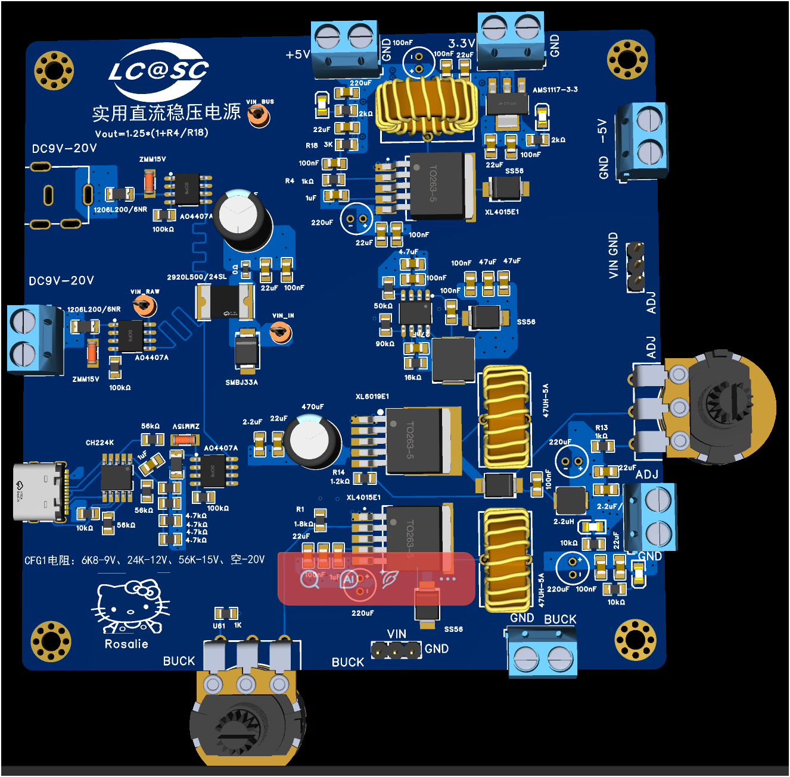

# 可调电源板 (Power Supply Board)

实用直流稳压电源 — 三路输入、多路输出的模块化电源板

## 概述

本板卡是 OpenPowerLab 项目的核心电源模块，提供 9–20 V 宽电压输入，输出 +3.3 V、+5 V、−5 V 三路固定电压和两路独立可调电压。支持 DC 插座、USB-C PD、接线端子三种输入方式（单路工作）。

## 技术规格

| 参数 | 规格 | 备注 |
| --- | --- | --- |
| **输入电压** | 9 – 20 V DC | 三路输入，仅可一路通电 |
| **输入接口** | DC 插座 / USB-C / 5.08mm 端子 | |
| **+3.3 V 输出** | 标称 1 A | AMS1117-3.3 LDO |
| **+5 V 输出** | 标称 5 A | XL4015 Buck |
| **−5 V 输出** | 待验证 | XL6019 Boost 反压 |
| **可调输出 1** | 1.25 V – VIN-2V（标称） | XL4015 + 电位器 |
| **可调输出 2** | 1.25 V – VIN-2V（标称） | XL4015 + 电位器 |
| **开关频率** | ~180 kHz | XL4015 固有频率 |
| **PCB 层数** | 2 层 | |
| **PCB 厚度** | 1.6 mm（默认） | |

> [!WARNING]
> 以上为器件标称值，未经实际测试验证。实际输出能力可能受散热、布局、输入电压等因素影响。

## 输入接口

### 1. DC 电源插座 (DC1)
- 型号：DC-005IB-2.1-09
- 规格：5.5 × 2.1 mm，中心正极
- 位置：板左侧上方

### 2. USB-C 接口 (USB2)
- 型号：KH-TYPE-C 16P
- 协议：USB PD 诱骗输出（CH224K 控制）
- PD 电压配置：通过 CFG1 电阻选择
  - 6.8 kΩ → 9 V
  - 24 kΩ → 12 V
  - 56 kΩ → 15 V
  - 不焊 → 20 V
- 位置：板左侧下方

### 3. 5.08 mm 接线端子 (U9/U10)
- 型号：弹片压线升降式端子 2P
- 间距：5.08 mm
- 适用：大电流输入或台式电源连接
- 位置：板顶部左右两侧 (+5V/GND 和 3.3V/GND 端子)

> [!CAUTION]
> **严禁同时给两个或以上输入端通电！** 这会导致电源之间倒灌，损坏电路板和外部电源。

## 输出接口

### 固定电压输出（5.08 mm 接线端子）

| 端子 | 电压 | 稳压方案 | 位置 |
| --- | --- | --- | --- |
| +5 V / GND | +5 V DC | XL4015 Buck | 顶部右侧 |
| +3.3 V / GND | +3.3 V DC | AMS1117-3.3 LDO | 顶部左侧 |
| −5 V / GND | −5 V DC | XL6019 反压 | 右侧中部 |

### 可调电压输出（5.08 mm 接线端子 + 电位器）

| 输出 | 调节方式 | 稳压方案 | 电位器 |
| --- | --- | --- | --- |
| ADJ1 (BUCK1) | 电位器连续可调 | XL4015E1 | WH148 (板底部左侧) |
| ADJ2 (BUCK2) | 电位器连续可调 | XL4015E1 | WH148 (板右侧中部) |

输出电压公式：**Vout = 1.25 × (1 + R4 / R18)**

### 测试点

| 标识 | 说明 |
| --- | --- |
| VIN_RAW | 输入原始电压（保险丝后） |
| VIN_BUS | 输入总线电压（反接保护后） |
| VIN_IN | 内部供电节点 |

## 电路原理

### 输入保护电路
每路输入均配有：
- **自恢复保险丝** (1206L200/6NR, 2A)：过流保护
- **ZMM15V 稳压管**：过压钳位
- **AO4407A P-MOSFET**：反接保护
- **SMBJ33A TVS**：输入端瞬态电压抑制

### 稳压通道

1. **+5 V 通道**：XL4015E1 同步降压，电感 47μH/5A，输出电容 220μF + 100nF
2. **+3.3 V 通道**：AMS1117-3.3 线性稳压，由 +5 V 进一步降压
3. **−5 V 通道**：XL6019E1 升压反压拓扑（待验证）
4. **ADJ1 通道**：XL4015E1 可调降压，WH148 电位器调节反馈分压
5. **ADJ2 通道**：XL4015E1 可调降压，WH148 电位器调节反馈分压

### CH224K PD 诱骗
- 通过配置电阻设置请求的 PD 电压档位
- 支持 9V / 12V / 15V / 20V 四档
- 自动协商，无需固件干预

## 核心元器件

### IC 芯片

| 位号 | 型号 | 封装 | 功能 | 数量 |
| --- | --- | --- | --- | --- |
| U11, U58 | XL4015E1 | TO-263-5 | 5A 降压 DC-DC | 2 |
| U16 | XL6019E1 | TO-263-5 | 升压 DC-DC（反压） | 1 |
| U20 | AMS1117-3.3 | SOT-223 | 3.3V LDO | 1 |
| U27 | CH224K | ESSOP-10 | USB PD 诱骗 | 1 |
| U15 | LMR14050SDDAR | SOIC-8 | 辅助降压 | 1 |

### 功率器件

| 位号 | 型号 | 封装 | 功能 | 数量 |
| --- | --- | --- | --- | --- |
| Q1, Q2, Q3 | AO4407A | SOP-8 | P-MOSFET 反接保护 | 3 |
| U13, U23, U25, U60 | SS56 | SMB | 5A/60V 肖特基二极管 | 4 |
| U2 | SMBJ33A | SMB | TVS 瞬态抑制 | 1 |
| D1, D2, D3 | ZMM15V | LL-34 | 15V 稳压管 | 3 |

### 磁性元件

| 位号 | 型号 | 感值 | 功能 |
| --- | --- | --- | --- |
| U12, U17, U59 | 47UH-5A | 47 μH | Buck 主电感 |
| L1 | 0410CDMCCDS-2R2MC | 2.2 μH | 辅助降压电感 |
| L2 | IHLP2525EZER5R6M01 | 5.6 μH | 储能电感 |

### 保护元件

| 位号 | 型号 | 规格 | 功能 |
| --- | --- | --- | --- |
| F1, F3, F4 | 1206L200/6NR | 2A 自恢复保险丝 | 输入过流保护 |
| U22 | 2920L500/24SL | 5A 自恢复保险丝 | 大电流通道保护 |

## 物料清单 (BOM)

完整 BOM 共 **52 种**元器件，详见 [BOM.csv](BOM.csv)。

BOM 字段说明：
- `Designator`：元器件位号
- `Footprint`：封装规格
- `Value`：参数值
- `Manufacturer Part`：原厂型号
- `Manufacturer`：制造商
- `Supplier Part`：LCSC 料号
- `Supplier`：供应商（主要为 LCSC 立创商城）

可直接将 BOM.csv 导入立创商城 BOM 配单工具进行批量采购。

## 文件说明

| 文件/目录 | 说明 |
| --- | --- |
| `source/POWER.epro2` | EasyEDA Pro 工程源文件（原理图 + PCB） |
| `gerber/power_expand.zip` | Gerber 制板文件（用于 PCB 生产） |
| `BOM.csv` | 物料清单 |

## 制板说明

> [!CAUTION]
> 制板前请务必核对 Gerber 文件与设计源文件的版本一致性。

- PCB 层数：2 层
- 建议板厚：1.6 mm
- 铜厚：1 oz（建议大电流路径 2 oz）
- 阻焊颜色：蓝色（参考渲染图）
- 丝印颜色：白色

## 已知问题

- **XL6019 负压电路**：EN 引脚配置和调压环路存在已知问题，−5 V 输出未经验证
- **LMR14050 电路**：辅助降压电路功能待确认
- 实际输出电流能力、纹波、效率等参数均未测试

## 相关文档

- [安全使用指南](../../docs/safety.md)
- [测试与验证计划](../../docs/testing.md)
- [硬件设计文档](../../docs/hardware.md)
